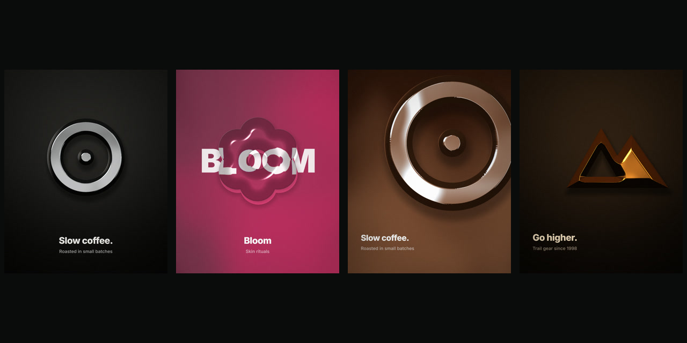
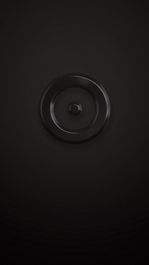
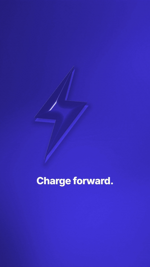
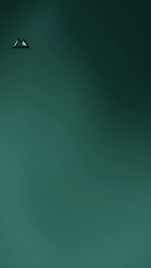
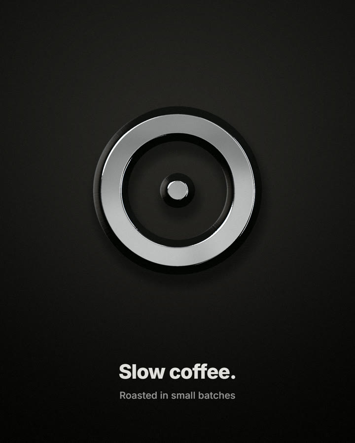
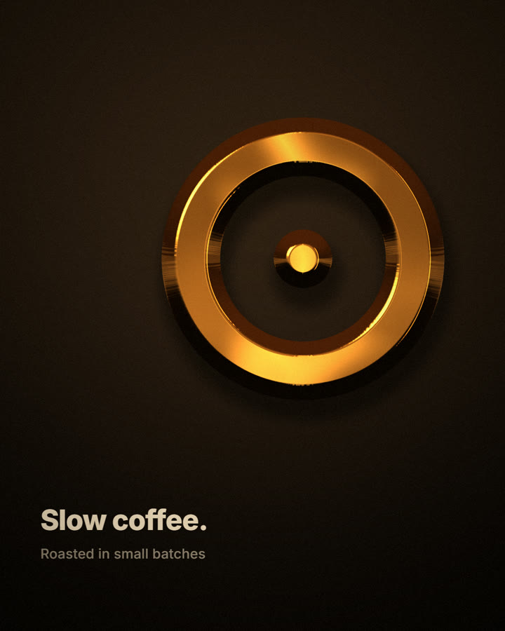
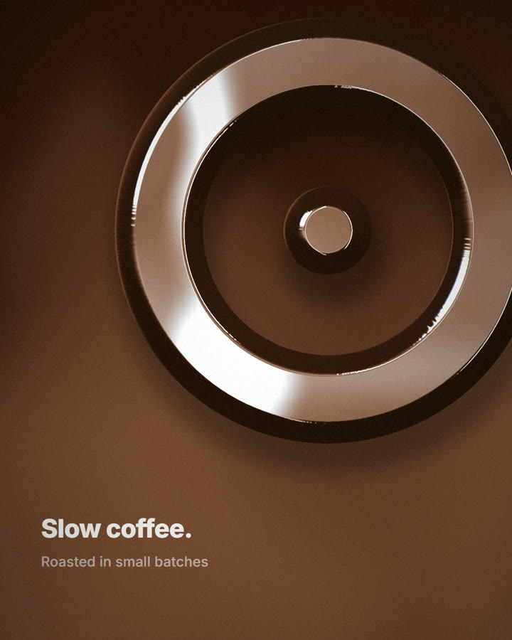
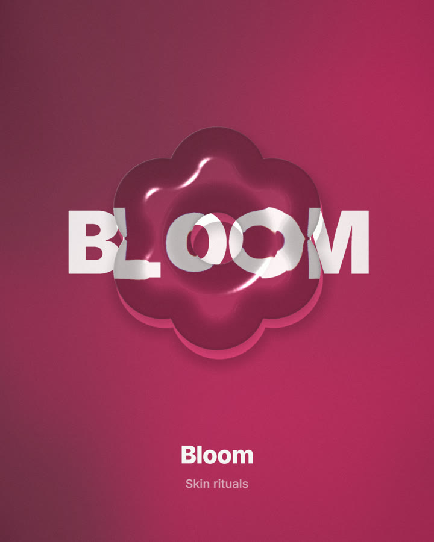
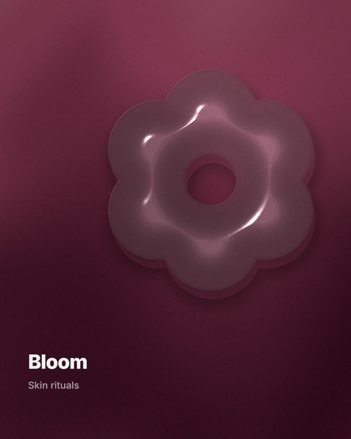
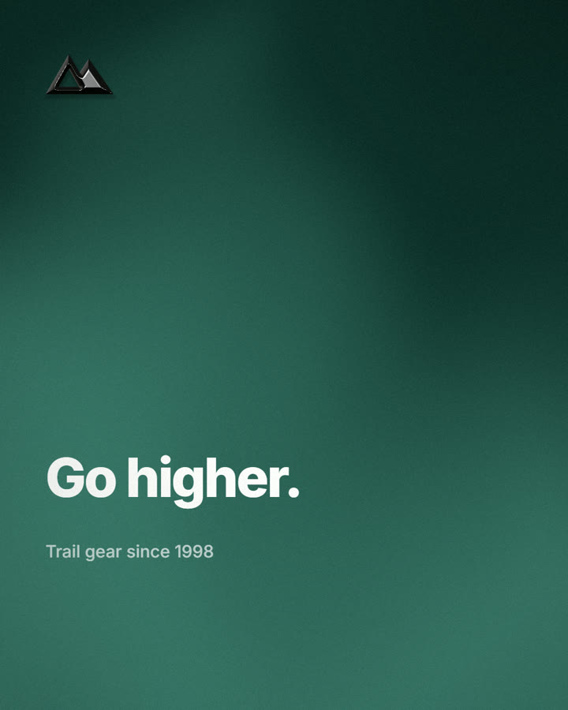

# Shader Brand Kit

**One logo in, a premium brand kit out.** A Claude Code skill (and standalone CLI) that turns any logo into liquid chrome, polished gold, thick refractive glass and silk-gradient posters, as Instagram posts, stories and looping reels, rendered on your own GPU in seconds.



<p>
  
  
  
</p>

```text
> make my logo chrome and give me a launch post + reel     (Claude picks the look, renders, reviews, iterates)
```

## Why it's different

- **Any logo, zero setup per logo.** The mark is converted into an exact signed distance field, so marks, wordmarks, thin strokes and even opaque JPGs (background keyed out automatically) get a real bevel, no tracing or 3D modelling needed.
- **Art direction built in.** Six looks with taste rules baked into their defaults: one material per image, metal on dark, glass only over something worth bending, brand colour auto-detected, 9:16 safe zones respected.
- **Built-in anti-slop review.** Every kit is graded CLEAN / MILD / SLOPPY / TERMINAL against measurable "made by AI" tells: unbranded violet, neon, blown highlights, no focal point, the same centred template on every post, and copy like *"Elevate your journey"*, *"not X, it's Y"*, em-dashes and emoji. Claude fixes these before you ever see the result.
- **Claude stays in the loop.** Every render ships with an editable JSON spec and a contact sheet. Claude looks at the result, edits the spec and re-renders, the same way a designer iterates.
- **Fast and local.** A full kit (6 stills and 2 reels) takes about 20 s on a laptop GPU. No cloud, no API keys, no telemetry.
- **Clean, original code.** A ~450-line WebGL2 engine written from scratch under the MIT licence.

## Install

**As a Claude Code plugin**

```bash
claude plugin marketplace add barissinall/shader-brand-kit
claude plugin install shader-brand-kit@barissinall-plugins
```

**As a plain skill:** copy `skills/shader-brand-kit/` to `~/.claude/skills/shader-brand-kit/`.

**Requirements:** Node 18+, Chrome, Edge or Chromium, and ffmpeg (for MP4). The first run installs a pinned `puppeteer-core` once. Check your setup with:

```bash
node skills/shader-brand-kit/scripts/brandkit.mjs doctor
```

## Use it

In Claude Code, just ask: *"turn logo.svg into a gold launch post"*, *"glass version of our logo over this photo"*, *"a 6-second chrome reveal for stories"*.

Or run the CLI yourself:

```bash
node skills/shader-brand-kit/scripts/brandkit.mjs logo.svg --text "Slow coffee." --sub "Roasted in small batches"
```

| flag | |
|---|---|
| `--looks chrome,gold,molten,glass,frost,silk` | which looks to render (default: all) |
| `--formats post,portrait,square,story,wide` | still sizes (post = 1080×1350) |
| `--reels chrome,glass,silk` / `none` | 1080×1920 MP4s (reveal / loop / flow) |
| `--photo img.jpg` · `--word "WORD"` | something for the glass to bend |
| `--colors "#hex"` · `--font brand.woff2` | override the detected colour, use your font |
| `--playground` | open a slider UI that exports the same JSON |
| `--spec specs/x.json` | re-render an edited spec |

Output: one PNG per look, MP4 reels, `contact-post.png`, an `index.html` gallery and a `specs/` folder with the recipe for every file.

## Looks

| | | |
|---|---|---|
|  **chrome**: mirror chrome on a black studio sweep |  **gold**: warm amber studio |  **molten**: chrome melting into the brand colour |
|  **glass**: the logo as a thick lens over a word or photo |  **frost**: milky glass, editorial layout |  **silk**: editorial poster with a small chrome mark |

## Not another AI-looking post

Chrome, liquid glass and gradients sit right on top of the 2025-26 "AI look", so the skill ships with a taste layer:

- **Layouts vary on purpose:** centred, editorial (off-centre mark, type hung from the left margin) and crop (oversized mark bleeding off the frame), so a kit reads as a series.
- **Palettes come from the brand:** the dominant colour is auto-detected and used muted for grounds and full strength for accents. Neutral brands get graphite, never stock indigo.
- **Automatic review** after every render (`review.json`) plus `node brandkit.mjs review <folder>` for any existing output.
- **[references/anti-slop.md](skills/shader-brand-kit/references/anti-slop.md):** the rules, the grade, a five-question vision self-check Claude runs on the contact sheet (*"swap the logo: would this still work for another brand?"*) and ten moves that read as human. It was compiled from Anthropic's frontend-design guidance, community anti-slop and taste skills, and designer write-ups.

```text
$ brandkit logo.svg --text "Not just coffee — it's a journey ✨"
[review] AI-look grade: TERMINAL  (4 warning(s), 2 note(s); CLEAN/MILD are shippable, fix SLOPPY/TERMINAL first)
  ! [copy] copy-cliche: uses stock AI phrasing (journey). Say the concrete thing only this brand could say...
  ! [copy] copy-emoji: contains emoji - never set emoji in poster type.
  ! [copy] copy-dash: uses an em/en dash as a separator - the most common LLM rhythm tell. Use a full stop.
  ! [copy] copy-flip: uses the "not X, it's Y" flip - an LLM fingerprint. State Y plainly.

$ brandkit logo.svg --text "Slow coffee." --sub "Roasted in small batches"
[review] AI-look grade: CLEAN
```

## How it works

The logo is rasterised and turned into a signed distance field with an exact Euclidean distance transform. A bevel profile turns distance into height, and finite differences turn height into normals. Metal reflects a procedural studio (softboxes, horizon, optional brand tint in the shadows). Glass refracts the background along the normals, with magnification, dispersion, Fresnel reflection, a rim highlight and a caustic in its shadow. Backgrounds are a lit, domain-warped noise surface ("silk"), a studio sweep or a photo. Headless Chrome renders frames on the GPU, and ffmpeg encodes them as H.264 with BT.709 colour tags.

## Security & privacy

The skill runs only local programs: Node, your installed Chrome and ffmpeg. Rendering makes no network requests, and nothing is uploaded. The one-time install fetches `puppeteer-core` from npm.

## Credits

Original code © 2026 barissinall, MIT. Inspired by the look of the liquid-metal and gradient shader community; **no third-party shader code is included**. See [THIRD_PARTY_NOTICES.md](THIRD_PARTY_NOTICES.md) for Inter (OFL), the hash function (MIT) and dependencies.

---

<sub>🇹🇷 **Kısaca:** Herhangi bir logodan tek komutla krom, altın, cam ve gradyan marka görselleri üretir: Instagram post, story ve reel. Her şey kendi GPU'nda, saniyeler içinde render edilir. Claude Code skill'i olarak çalışır, sonucu kendisi inceleyip düzeltir.</sub>
